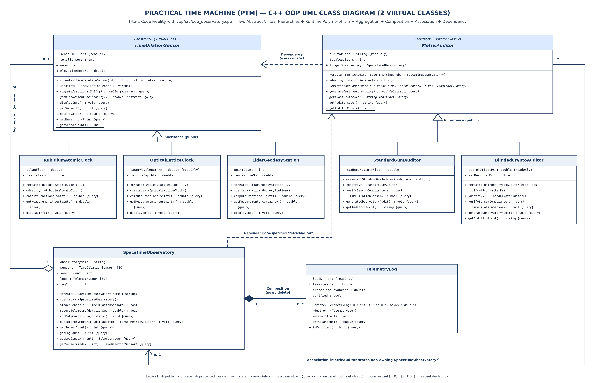

# Practical Time Machine (PTM) — Pure C++14 Spacetime Engineering Platform

**Subtitle:** Native Object-Oriented C++14 Relativistic Metrology, 3D LiDAR Geodesy, Computer Vision, and Spacetime Digital Twin Platform (Pure `.cpp` Architecture — Zero `.hpp` Headers).

---
[Video demonstration](https://drive.google.com/file/d/1uPqUT2GegT6num9Lq7J0O7jT6Q6xUJ89/view?usp=drivesdk)
[GitHub url](https://github.com/ananya39836-blip/practical-time-machine/tree/main)

[Streamlit Application URL](https://practical-time-machine.streamlit.app/)

## Executive Overview
The **Practical Time Machine (PTM)** platform is an engineered C++14 spacetime metrology system implementing General Relativistic proper time dilation ($\Delta f / f_0 = g \Delta h / c^2$), real-time Kalman filtering, 3D LiDAR point-cloud geodesy, 200 Hz computer vision beam tracking, 3D spacetime geodesic ray-tracing, and a UML-verified **Object-Oriented Runtime Polymorphism Architecture with Two Abstract Virtual Base Classes**.

- **Language:** Pure **C++14** (`.cpp` files only, zero `.hpp` files, zero external dependencies)
- **IDE Support:** Pre-configured **VS Code** workspace ([`ptm-cpp.code-workspace`](ptm-cpp.code-workspace) & [`.vscode/`](.vscode/))
- **CI/CD:** Automated GitHub Actions C++14 build & unit-test pipeline ([`.github/workflows/cpp-ci.yml`](.github/workflows/cpp-ci.yml))
- **Documentation:** 41 technical volumes (1,640 pages) in [`documents/`](documents/)

---

## UML Class Diagram (Two Virtual Classes & Runtime Polymorphism)

Every class, attribute, visibility specifier (`+`, `-`, `#`), `static` member, `const` (`{readOnly}` / `{query}`), pure virtual (`{abstract}`), virtual destructor (`{virtual}`), and pointer lifecycle matches [`cpp/src/oop_observatory.cpp`](cpp/src/oop_observatory.cpp) **1-to-1**:



- **Vector PDF:** [`cpp/uml/PTM_UML_Class_Diagram.pdf`](cpp/uml/PTM_UML_Class_Diagram.pdf)
- **PlantUML Source:** [`cpp/uml/PTM_UML_Class_Diagram.puml`](cpp/uml/PTM_UML_Class_Diagram.puml)
- **Draw.io Diagram:** [`cpp/uml/PTM_UML_Class_Diagram.drawio`](cpp/uml/PTM_UML_Class_Diagram.drawio)

### OOP & Memory Lifecycle Highlights
1. **Virtual Class 1 (`«Abstract» TimeDilationSensor`):** Pure virtual `computeFractionalShift() const = 0`, `getMeasurementUncertainty() const = 0`, `virtual ~TimeDilationSensor()`, static sensor counter, inherited by `RubidiumAtomicClock`, `OpticalLatticeClock`, and `LidarGeodesyStation`.
2. **Virtual Class 2 (`«Abstract» MetricAuditor`):** Pure virtual `verifySensorCompliance(const TimeDilationSensor&) const = 0`, `generateObservatoryAudit() const = 0`, `getAuditProtocol() const = 0`, `virtual ~MetricAuditor()`, inherited by `StandardGumAuditor` and `BlindedCryptoAuditor`.
3. **Runtime Polymorphism:** `SpacetimeObservatory` dynamically dispatches via both `TimeDilationSensor*` and `MetricAuditor*` base-class pointers.
4. **Aggregation (Hollow Diamond):** `SpacetimeObservatory` holds non-owning `TimeDilationSensor* sensors[10]` (NOT deleted in `~SpacetimeObservatory()`).
5. **Composition (Filled Diamond):** `SpacetimeObservatory` allocates `TelemetryLog* logs[50]` via `new` and deletes every log in `~SpacetimeObservatory()`.
6. **Association & Dependency:** `MetricAuditor` associates with `SpacetimeObservatory*` (non-owning) and depends temporarily on `const TimeDilationSensor&`.

---

## Pure `.cpp` Project Structure (`cpp/`)
```
time-machine-project/
├── .vscode/                      # VS Code C++ IntelliSense, Tasks (Ctrl+Shift+B), GDB Launch
├── .github/workflows/cpp-ci.yml  # Automated C++14 GitHub Actions build & unit tests
├── ptm-cpp.code-workspace        # 1-click VS Code C++ Workspace
├── cpp/
│   ├── src/
│   │   ├── main.cpp                    # Master CLI entry point (--all, --oop, --benchmark, ...)
│   │   ├── tests.cpp                   # Automated 9-suite C++ unit test runner
│   │   ├── oop_observatory.cpp         # 2 Virtual Classes + Runtime Polymorphism (1-to-1 UML)
│   │   ├── constants.cpp               # CODATA physical constants
│   │   ├── types.cpp                   # Core structs & telemetry types
│   │   ├── math_utils.cpp              # Matrix algebra, Gauss-Jordan, OLS, Durbin-Watson
│   │   ├── relativistic_model.cpp      # GR gravitational shift, Lorentz, Shapiro, Sagnac
│   │   ├── clock_noise.cpp             # Power-law noise & overlapping Allan deviation
│   │   ├── kalman_filter.cpp           # 3-state discrete relativistic Kalman filter
│   │   ├── lidar_geodesy.cpp           # 3D LiDAR point cloud, RANSAC, Edlén refraction
│   │   ├── computer_vision.cpp         # 200 Hz beam centroid & Ramsey-Bordé fringes
│   │   ├── spacetime_digital_twin.cpp  # Metric tensor g_uv & RK4 null geodesic ray-tracer
│   │   ├── data_validator.cpp          # MAD filter, diurnal de-trending, whiteness
│   │   ├── blinded_audit.cpp           # REQ-SYS-020 cryptographic blinding (<0.1 ps)
│   │   └── daq_daemon.cpp              # Autonomous DAQ state machine & CSV logger
│   ├── uml/                            # UML Class Diagrams (.pdf, .png, .puml, .drawio)
│   ├── bin/                            # Compiled executables (ptm_engine.exe, ptm_tests.exe)
│   ├── build.bat                       # Windows 1-click GCC build script
│   ├── Makefile                        # Cross-platform GNU Make build
│   └── CMakeLists.txt                  # Modern CMake configuration
├── documents/                          # 41 Technical Volumes (1,640 pages)
└── README.md
```

---

## Build & Run Instructions (Single Command)

### Option 1: VS Code
1. Open [`ptm-cpp.code-workspace`](ptm-cpp.code-workspace) in VS Code.
2. Press **`Ctrl+Shift+B`** to build both `ptm_engine.exe` and `ptm_tests.exe`.
3. Press **`F5`** to run/debug (`C++ Debug: PTM Engine (--all)`, `--oop`, or `PTM Unit Test Suite`).

### Option 2: Direct `g++` (Windows / Linux / macOS)
```bash
cd cpp
g++ -std=c++14 -O3 -Wall -Wextra -Isrc src/main.cpp -o bin/ptm_engine
g++ -std=c++14 -O3 -Wall -Wextra -Isrc src/tests.cpp -o bin/ptm_tests
./bin/ptm_tests
./bin/ptm_engine --all
```

### Option 3: Windows Batch / Make / CMake
```cmd
cd cpp
build.bat
.\bin\ptm_tests.exe
.\bin\ptm_engine.exe --oop
.\bin\ptm_engine.exe --all
```

---

## CLI Operational Modes (`ptm_engine`)
| Flag | Description |
| :--- | :--- |
| `--all` | Execute complete Level-10 relativistic, LiDAR, CV, digital twin, benchmark & OOP suite |
| `--oop` | Execute 2-Virtual-Class Runtime Polymorphism, Aggregation, Composition & Audit demo |
| `--simulate` | 72-hour proper time dilation simulation & discrete Kalman state estimator |
| `--lidar` | 3D LiDAR point cloud geodesy & Edlén refraction metrology |
| `--cv` | 200 Hz closed-loop beam tracking & Ramsey-Bordé fringe extraction |
| `--raytrace` | 3D spacetime metric tensor RK4 null geodesic ray-tracing |
| `--blind-test` | REQ-SYS-020 cryptographic blinded injection & recovery ($< 0.1\text{ ps}$) |
| `--real-data` | Tokyo Skytree, IGS GPS Constellation & NASA DSAC validation |
| `--benchmark` | 1,000,000-iteration C++ Kalman filter throughput benchmark (~810,000 updates/sec) |
